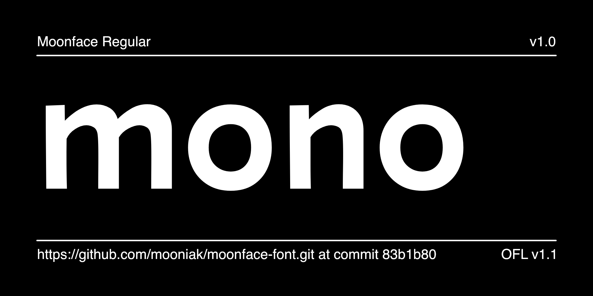
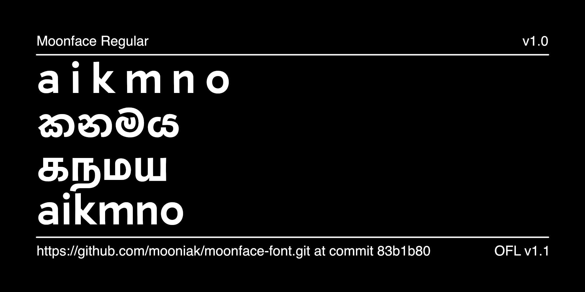

# Moonface

[![Build][badge-build]][link-build]
[![Fontspector QA][badge-qa]][link-qa]
[![Release][badge-release]][link-release]

[badge-build]: https://github.com/mooniak/moonface-font/actions/workflows/build.yaml/badge.svg?branch=dev
[badge-qa]: https://img.shields.io/badge/dynamic/json?url=https%3A%2F%2Fsrc.mooniak.com%2Fmoonface-font%2Fbuild.json&query=%24.qa.pass_rate&suffix=%25&label=fontspector%20QA%20(dev%20build)&color=informational
[badge-release]: https://img.shields.io/github/v/release/mooniak/moonface-font?label=release
[link-build]: https://github.com/mooniak/moonface-font/actions/workflows/build.yaml
[link-qa]: https://src.mooniak.com/moonface-font/reports/fontspector/fontspector-report.html
[link-release]: https://github.com/mooniak/moonface-font/releases

Moonface is a Latin display typeface designed by Pathum Egodawatta under the [Mooniak](https://mooniak.com/) foundry, released under the SIL Open Font License. The font is a work in progress: only a handful of Latin letters (a, i, k, m, n, o) and a few Tamil and Sinhala letters are drawn so far, which is what the specimens below show.

## Building

Fonts are built automatically by GitHub Actions - take a look in the "Actions" tab for the latest build.

If you want to build fonts manually on your own computer:

- `make build` will produce font files.
- `make test` will run [FontBakery](https://github.com/googlefonts/fontbakery)'s quality assurance tests.
- `make proof` will generate HTML proof files.

QA reports and proofs are published at https://src.mooniak.com/moonface-font/.

## License

This Font Software is licensed under the SIL Open Font License, Version 1.1.
The license text is in [OFL.txt](OFL.txt); a FAQ is at https://openfontlicense.org.
